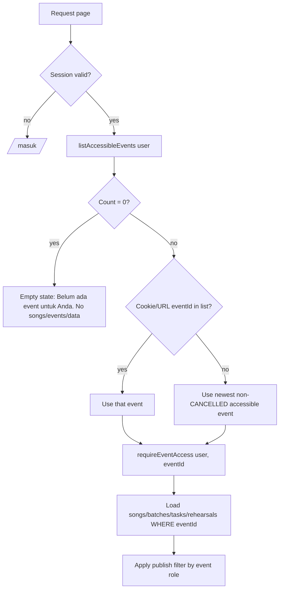

# 13 — Plan: Event Ibadah Internal GEHC

Status: **Implementasi bertahap pada branch `feature/gehc-events`; belum dirilis.** P1/P2 sudah di-commit lokal; P3–P5 diimplementasikan bertahap. Semua keputusan terbuka ada di §10. Update 2 Nov 2026: Q6–Q8 resolved. Update 3 Nov 2026: Q1–Q5 resolved. **Semua open question resolved.**

## 1. Goal
MYTH mendukung lebih dari satu event secara bersamaan:
- Event **regional** yang sudah ada (Wilayah Jabodetabek–Bandung; kemungkinan Batam).
- Event baru **Ibadah Internal GEHC** (GMIM Eben Haezer Cikarang) dengan setlist, chord, batch, rehearsal, dan personel sendiri.

Each member sees only the events they are assigned to. One GEHC event = one ibadah (Q3). Songs live in one shared **Pustaka Lagu** (library); each event picks songs from it into its own setlist (Q5). Each event has its own admin (event admin). Existing regional data stays unchanged.

## 2. Context (current state)
| Area | Current behavior | Ref |
|---|---|---|
| Event | Satu model `Event`, tanpa type/region. Tidak ada relasi ke User/Person. | `prisma/schema.prisma` (`model Event`) |
| Current event | App memakai satu "current event": event terbaru yang tidak `CANCELLED`. | `server/services/event-service.ts` → `getCurrentEvent()` |
| Scoping | Song, SongBatch, Task, Rehearsal, EquipmentItem, DecisionLog punya `eventId` (cascade). | `schema.prisma`, `src/lib/validation/*.ts` |
| Role | Global saja: `ADMIN`, `USER`, `OBSERVER` ("Pantau") di `User.role`. | `src/lib/permissions.ts`, docs/06 |
| Song visibility | USER/OBSERVER melihat semua lagu `isPublished` (commit `720c5e6`). | `src/app/(app)/songs/*`, `batches/*` |
| Dashboard | Data untuk `getCurrentEvent()` saja. | `src/app/(app)/dashboard/page.tsx`, `server/services/dashboard-service.ts` |
| Multi-event | Ditandai **P2** di docs/09. | docs/09 §Priority |
| Deploy | `vercel-build` = `prisma generate && next build`. **Tidak ada** `prisma migrate deploy`. | `package.json` |
| DB | TiDB (MySQL). `String` tanpa `@db.Text` = `VARCHAR(191)`. | docs/12, rehearsal agenda incident |

Problem: if we create a second event now, `getCurrentEvent()` picks only one, and all USER accounts see all published songs from every event.

## 3. Scope
**In scope**
- `Event.eventType` (REGIONAL / INTERNAL_GEHC) and optional region.
- `EventMembership` (user ↔ event, with event role).
- Event switcher and dashboard filtered by membership.
- Server-side checks for every event-scoped read and mutation.
- Migration + backfill so all current users keep access to the 14 Nov regional event.
- Shared song library (`Song` global) + `EventSong` setlist per event, with migration of existing songs (Q5).
- Membership management (existing accounts only) by EVENT_ADMIN (Q4).

**Out of scope**
- Changes to the chart editor (ChartSection/ChartArrangement stay per library song).
- Account create/reset by EVENT_ADMIN (super admin only, Q4).
- Region-based access (region = label only, Q2).
- Recurring/template GEHC events (each ibadah is created as its own event, Q3).
- Google Drive API, notifications, calendar export.
- Public / unauthenticated pages.

## 4. Data model changes
### 4.1 Enums and fields
| Change | Type | Default | Note |
|---|---|---|---|
| `Event.eventType` | enum `EventType { REGIONAL, INTERNAL_GEHC }` | `REGIONAL` | Existing rows become REGIONAL automatically. |
| `Event.region` | `String?` | `null` | e.g. `JABODETABEK_BANDUNG`, `BATAM`. **Label only, no access effect** (Q2). |
| `EventMembership` | new model | — | Access unit. |
| `EventRole` | enum `EVENT_ADMIN, MEMBER, OBSERVER` | `MEMBER` | Role inside one event. |
| `Event.accessClosedAt` | `DateTime?` | `null` | Set by "Tutup akses" (Q8). `null` = open. |
| `EventSong` | new model | — | Setlist item: event ↔ library song, order + event-specific fields (Q5). |
| `SongAssignment.eventId`, `PracticeProgress.eventId`, `SongMaterial.eventId?`, `SongBatchItem` → `EventSong` | new FK columns | nullable first | Event-specific data moves under the event (Q5). |
| `Event.accessClosedById` | `String?` | `null` | User who closed access (audit). |

### 4.2 Prisma sketch
```prisma
enum EventType {
  REGIONAL
  INTERNAL_GEHC
}

enum EventRole {
  EVENT_ADMIN
  MEMBER
  OBSERVER
}

model Event {
  // ...existing fields
  eventType   EventType @default(REGIONAL)
  region      String?   @db.VarChar(64)
  accessClosedAt   DateTime?
  accessClosedById String?   @db.VarChar(191)
  memberships EventMembership[]

  @@index([eventType, eventStatus])
}

model EventMembership {
  id        String    @id @default(cuid())
  eventId   String
  event     Event     @relation(fields: [eventId], references: [id], onDelete: Cascade)
  userId    String
  user      User      @relation(fields: [userId], references: [id], onDelete: Cascade)
  role      EventRole @default(MEMBER)
  note      String?   @db.Text
  createdAt DateTime  @default(now())
  updatedAt DateTime  @updatedAt

  @@unique([eventId, userId])
  @@index([userId])
}

model User {
  // ...existing fields
  memberships EventMembership[]
}

// Q5: Song = global library item (chords in C, original key, credits).
model Song {
  // ...existing library fields: title, artistOrAuthor, key (original key),
  // bpm, timeSignature, chartSections, chartArrangements, versions
  eventId          String?   // EXPAND: nullable now; DROP only in a later contract release
  arrangerCredits  String?   @db.Text
  libraryStatus    String?   @db.VarChar(32) // e.g. ACTIVE | ARCHIVED (optional)
  eventSongs       EventSong[]
}

// Setlist entry: one library song inside one event.
model EventSong {
  id               String     @id @default(cuid())
  eventId          String
  event            Event      @relation(fields: [eventId], references: [id], onDelete: Cascade)
  songId           String
  song             Song       @relation(fields: [songId], references: [id], onDelete: Restrict)
  sortOrder        Int        @default(0)
  eventKey         String?    @db.VarChar(16)  // key for this event; null = Song.key
  liturgicalFunction String?  @db.VarChar(191)
  notes            String?    @db.Text         // event arrangement notes
  status           SongStatus @default(DRAFT)  // per-event readiness
  isPublished      Boolean    @default(false)
  isFinalLocked    Boolean    @default(false)
  createdAt        DateTime   @default(now())
  updatedAt        DateTime   @updatedAt

  @@unique([eventId, songId])
  @@index([eventId, sortOrder])
  @@index([eventId, isPublished])
}
```
Event-specific child tables get `eventSongId` (or `eventId`) so the same library song can have different assignments/progress per event:

| Table | New column | New unique |
|---|---|---|
| `SongAssignment` | `eventSongId String?` | — |
| `PracticeProgress` | `eventSongId String?` | `@@unique([eventSongId, personId])` (old `songId+personId` kept until contract) |
| `SongBatchItem` | `eventSongId String?` | batch is already per event |
| `RehearsalSong` | `eventSongId String?` | — |
| `SongMaterial` | `eventId String?` | `null` = library material (Original, Chord Chart, Sequencer); set = event-only material |
| `Task.relatedSongId`, `DecisionLog.relatedSongId` | unchanged | resolve event via the record's own `eventId` |
Rules:
- Membership links to `User` (login identity), not `Person`. SongAssignment stays on `Person`.
- Free-text fields use `@db.Text` to avoid the `VARCHAR(191)` gotcha.
- Global `User.role` stays. It keeps meaning for global ADMIN (see §6).

### 4.3 Migration + backfill
Expand → migrate → contract. This plan covers **expand + migrate** only. Contract (drop `Song.eventId`, old uniques) is a later release after owner approval.

1. `prisma migrate dev --name event_type_membership` locally. SQL only `ADD COLUMN` / `CREATE TABLE` / `CREATE INDEX`. No drop.
2. Membership backfill (idempotent, `INSERT ... SELECT ... ON DUPLICATE KEY UPDATE`):
   - Every existing event → `eventType = REGIONAL`, `region = 'JABODETABEK_BANDUNG'`.
   - Every active user → membership only on the current regional event (same newest non-`CANCELLED` selection as `getCurrentEvent()`, the 14 Nov event): `ADMIN` → `EVENT_ADMIN`, `USER` → `MEMBER`, `OBSERVER` → `OBSERVER`. Do not grant membership automatically to older regional events.
   - Owner `aisaerang` (global ADMIN) gets `EVENT_ADMIN` on every GEHC event he creates (Q1). Do this in the "create event" action, not in the backfill.
3. Library migration `song_library` (Q5), idempotent:
   - Every existing `Song` stays as the library row (same `id`) → chart sections, arrangements, versions, chords in C and original key are untouched.
   - For each Song: create `EventSong(eventId = Song.eventId, songId = Song.id)` copying `status`, `isPublished`, `isFinalLocked`, `liturgicalFunction`, `arrangementNotes → notes`; `sortOrder` from current batch order.
   - Set `eventSongId` on `SongAssignment`, `PracticeProgress`, `SongBatchItem`, `RehearsalSong` via join on `songId` + `Song.eventId`.
   - `SongMaterial`: keep `eventId = NULL` (library) for all current rows. Owner may later mark event-only materials.
   - Verify counts: `EventSong` = old Song count; every assignment/progress/batch item/rehearsal song row has `eventSongId`. Fail the migration (SQL `SIGNAL`) or report if not.
4. Code reads `EventSong` after this release; `Song.status/isPublished` become legacy (kept, not written) until contract.
3. Migrations run **automatically at build** (Q6, resolved 2 Nov 2026). Change `package.json`:
   `"vercel-build": "prisma generate && prisma migrate deploy && next build"`.
   Rules:
   - Migrations must be **additive and safe**: add column (nullable or with default), add table, add index. No drop/rename in the same release as code that still uses the old shape (expand → migrate → contract over 2 releases).
   - A failed `migrate deploy` fails the build, so the old deployment stays live. Good.
   - Backfill is **idempotent** (`upsert`). Run it as a separate step (`npm run backfill:membership`) or inside the migration SQL (`INSERT ... SELECT ... ON DUPLICATE KEY UPDATE`). Prefer SQL in the migration so it runs in the same build.
   - **Preview vs production DB:** Vercel Preview builds also run `vercel-build`. If Preview uses the production `DATABASE_URL`, a PR branch can migrate production. Set a separate Preview `DATABASE_URL` (TiDB branch/dev DB), or skip `migrate deploy` when `VERCEL_ENV !== "production"`.
   - Back up / snapshot TiDB before the first release with this change.

Membership and library migrations are separate migration files, but both run in the same build.

Order still matters: the migration + backfill must succeed **in the same build** before code that requires membership goes live. `migrate deploy` before `next build` guarantees this.

## 5. Dashboard filtering logic
### 5.1 Flow


### 5.2 Pseudo-code
```ts
// server/services/event-access.ts (new)
async function listAccessibleEvents(user) {
  if (user.role === "ADMIN") return prisma.event.findMany(orderNewest); // incl. closed
  return prisma.event.findMany({
    where: {
      memberships: { some: { userId: user.id } },
      // closed events stay visible to their EVENT_ADMIN only (Q8)
      OR: [
        { accessClosedAt: null },
        { memberships: { some: { userId: user.id, role: "EVENT_ADMIN" } } },
      ],
    },
    ...orderNewest,
  });
}

async function getEventRole(user, eventId): Promise<EventRole | null> {
  if (user.role === "ADMIN") return "EVENT_ADMIN";       // global super-admin
  const m = await prisma.eventMembership.findUnique({
    where: { eventId_userId: { eventId, userId: user.id } },
  });
  if (!m) return null;                                     // Q7: no membership = nothing
  const ev = await prisma.event.findUnique({ where: { id: eventId }, select: { accessClosedAt: true } });
  if (ev?.accessClosedAt && m.role !== "EVENT_ADMIN") return null; // Q8: closed
  return m.role;
}

async function requireEventAccess(user, eventId, min: EventRole = "OBSERVER") {
  const role = await getEventRole(user, eventId);
  if (!role || rank(role) < rank(min)) notFound();      // 404, not 403: hide existence
  return role;
}

// replaces getCurrentEvent()
async function getActiveEventFor(user, requestedId?) {
  const events = await listAccessibleEvents(user);
  return events.find(e => e.id === requestedId)
      ?? events.find(e => e.eventStatus !== "CANCELLED")
      ?? null;
}
```

### 5.3 Empty state (Q7, resolved 2 Nov 2026)
- User without any membership (or only closed events) sees only the message "Belum ada event untuk Anda. Hubungi admin." plus logout/profile.
- Nav links to songs/batches/rehearsals/tasks/equipment are hidden; direct URLs return 404.
- No auto-join. Global ADMIN is excepted (sees all).

### 5.4 Event switcher
- Dropdown in the app header. Show only when the user has 2+ accessible events.
- Label: `[Regional] Ibadah Wilayah 14 Nov` / `[GEHC] Ibadah Internal ...`.
- Store selection in cookie `myth_event` (not a secret). Always re-validate on the server.
- Detail pages (`/songs/[id]`, `/rehearsals/[id]`, ...) load the record, then call `requireEventAccess(user, record.eventId)`.

## 6. RBAC implications
### 6.1 Two levels
| Level | Who | Power |
|---|---|---|
| Global `ADMIN` (super admin) | Owner / MD (`aisaerang`) | All events; **only role that creates/resets/deactivates accounts** (Q4); create events; assign event admins; manage Pustaka Lagu. |
| `EVENT_ADMIN` | e.g. admin GEHC | Full music/ops CRUD **in that event only**; add/remove/change role of **existing** accounts in that event (Q4). No account create/reset. Owner is currently EVENT_ADMIN of the GEHC event (Q1). |
| `MEMBER` | Pemusik | Same as current USER, scoped to the event. |
| `OBSERVER` | Pantau | Same as current OBSERVER, scoped to the event. |
| No membership | — | Event is invisible (404). With zero memberships: empty state only (Q7). |

### 6.2 Access matrix (per event)
| Area | Global ADMIN | EVENT_ADMIN | MEMBER | OBSERVER | Not assigned |
|---|---|---|---|---|---|
| See event in switcher | ✓ | ✓ | ✓ | ✓ | ✗ |
| Event brief edit | ✓ | ✓ | ✗ | ✗ | ✗ |
| Pustaka Lagu: create/edit library song, chords (C), original key, credits | ✓ | ✗ (see §6.4) | ✗ | ✗ | ✗ |
| Setlist: add/remove/order EventSong, event key/notes/status/publish | ✓ | ✓ | ✗ | ✗ | ✗ |
| Batches/assignments in event | ✓ | ✓ | ✗ | ✗ | ✗ |
| Pustaka Lagu read (to pick songs) | ✓ | ✓ | ✗ | ✗ | ✗ |
| Songs read | all incl. DRAFT | all incl. DRAFT | all published songs in member events | published | ✗ |
| Own progress update | ✓ | ✓ | ✓ | ✗ | ✗ |
| All progress read | ✓ | ✓ | ✗ | published | ✗ |
| Suggestions (task TODO) | — | — | ✓ | ✓ | ✗ |
| Rehearsal/equipment CRUD | ✓ | ✓ | ✗ | ✗ | ✗ |
| Rehearsal read | ✓ | ✓ | ✓ | ✓ | ✗ |
| Decisions | ✓ | ✓ | ✗ | ✗ | ✗ |
| Event memberships (existing accounts) | ✓ | ✓ (cannot remove last admin) | ✗ | ✗ | ✗ |
| Close / reopen access (Q8) | ✓ | ✓ | ✗ | ✗ | ✗ |
| View closed event | ✓ | ✓ | ✗ | ✗ | ✗ |
| Accounts / audit / settings | ✓ | ✗ | ✗ | ✗ | ✗ |

### 6.3 Server-side checks
- Add to `src/lib/permissions.ts`: `canManageEvent(eventRole)`, `canReadDrafts(eventRole)`, `canManageMembers(eventRole)`. Keep the existing global helpers.
- Every server action in `server/actions/*` that takes or touches an `eventId`: resolve the event from the record (never trust the form), then `requireEventAccess`.
- Replace `isAdmin(user)` checks for event data with `canManageEvent(role)`. Keep `isAdmin` for accounts.
- Publish filter (`isPublished`) from commit `720c5e6` stays, but runs **after** the event filter.
- Audit: log membership add/remove/role change (`entityType = EventMembership`).
- Close access (Q8, resolved 2 Nov 2026): action "Tutup akses event" sets `accessClosedAt`/`accessClosedById`. Only that event's EVENT_ADMIN or global ADMIN. It is never automatic: `eventStatus = COMPLETED` alone does not close access. "Buka kembali akses" clears the fields. Both write AuditLog (`event.access_closed` / `event.access_reopened`). Closed event = read-only for EVENT_ADMIN unless reopened.
- Account actions (`server/actions/*user*`, invite, reset): keep `isAdmin(user)` (global). EVENT_ADMIN membership action only searches existing active accounts (Q4).
- Region is never used in any access check (Q2).
- Guard: an event must keep at least one `EVENT_ADMIN` or global ADMIN.

### 6.4 Songs: Pustaka Lagu + setlist per event (Q5, resolved 3 Nov 2026)
- `Song` = library item. It holds title, credits (artist, arranger), **chords stored transposed to C**, **original key** in `Song.key`, chart sections/arrangements, library materials.
- `EventSong` = the song inside one event setlist. It holds order, event key (`eventKey`), notes, status, publish, final lock, and links to batch, assignments, progress, rehearsal.
- Display key = `EventSong.eventKey ?? Song.key`; chart renders from C to that key.
- Editing library chords changes the chart for **every** event that uses the song. Show a warning: "Lagu ini dipakai di N event."
- Library edit = global ADMIN only (assumption; EVENT_ADMIN may be allowed later). EVENT_ADMIN picks from the library and edits only `EventSong` fields.
- Members see a library song only through an `EventSong` of an event they belong to, and only when `EventSong.isPublished` (or they are admin). No direct library browsing for MEMBER/OBSERVER.
- Removing a song from a setlist deletes the `EventSong` (with its event data, after confirm); never deletes the library `Song` (`onDelete: Restrict`).

## 7. Implementation steps
| Phase | Work | Done when |
|---|---|---|
| P1 Schema + migration + backfill | Enums, `Event` fields, `EventMembership`, `EventSong`, nullable FK columns; membership + library backfill SQL; `vercel-build` with `prisma migrate deploy`. | `migrate dev` and `migrate deploy` (2×) pass on a local/dev DB; counts check OK; SQL has no `DROP TABLE`/`DROP COLUMN`/data deletion. A `DROP FOREIGN KEY` or `DROP INDEX` is allowed only with its replacement added in the same migration. |
| P2 Access layer | `event-access.ts`, permissions helpers, unit tests, membership-scoped event lists and event-scoped read/detail routes, a pre-render Proxy guard for real HTTP 404s, plus the no-membership empty state. | No-membership user sees no event data; another event's direct URL is HTTP 404; global ADMIN sees all. |
| P3 Library + setlist reads | Songs pages read via `EventSong`; display key logic; library page for admins. | 14 Nov event shows same songs, order, key, status, progress as before. |
| P4 Scope reads | Replace `getCurrentEvent()` with `getActiveEventFor(user)` in dashboard, batches, rehearsals, tasks, equipment, decisions, timeline; empty state. | Non-member gets 404 / empty state. |
| P5 Scope writes | All server actions check event role from the record; writes go to `EventSong` + new FKs. | GEHC EVENT_ADMIN cannot mutate regional data; library edit only by global ADMIN. |
| P6 UI | Event switcher, type badge, create event (type/region, auto EVENT_ADMIN for creator), members page (existing accounts), "Tambah dari Pustaka" picker. | Owner creates a GEHC ibadah event, picks songs, assigns members. |
| P7 Close access | "Tutup akses"/"Buka kembali" + audit. | Tests in §8 pass. |
| P8 Release (owner) | Separate Preview `DATABASE_URL`; TiDB snapshot; merge to main by owner. | Regional members still see 14 Nov unchanged; GEHC test user sees only GEHC. |
| P9 Contract (later) | Drop `Song.eventId`, legacy Song status fields, old uniques. | Only after owner approval and 1 stable release. |

P3 implementation: setlist and song-detail reads now resolve through `EventSong`, display `EventSong.eventKey ?? Song.key`, scope song materials/tasks/progress to the selected event, and expose the shared library page to global ADMIN only. MEMBER reads include every published song in an accessible event (assignment is required only for progress updates); other events remain inaccessible. Song detail links retain `eventId`. No database command, migration, seed, or production/DEV data mutation was run for P3.

P4 implementation: dashboard, batch, rehearsal, task, equipment, and decision list reads resolve an explicitly requested event only from the user's accessible events. Dashboard and timeline data use event-scoped setlist state; user timeline attendance is restricted to rehearsals in the selected event. Dashboard links retain `eventId`, inaccessible requested events return 404, and users without memberships see an empty dashboard ("Belum terdaftar di acara mana pun"). With Cache Components enabled, dashboard and song-list data rendering wait for a request via `connection()` inside Suspense boundaries before database reads; the app navigation computes membership visibility through a request-time private cache function, avoiding an extra prerender-time query. This keeps the MariaDB pool's internal `Date.now()` health checks out of prerendering. No database command, migration, seed, or production/DEV data mutation was run for P4.

P5 implementation: event-scoped server actions resolve the event from the persisted Event, EventSong, batch, task, rehearsal, equipment, or material record before allowing writes. EVENT_ADMIN can mutate only open events where they hold that role; a closed event is read-only for EVENT_ADMIN. MEMBER/OBSERVER cannot use event-management actions. Global ADMIN retains cross-event access, while account/personnel management and shared chart/library editing remain global-ADMIN-only. Song creation adds a library Song plus its EventSong; publish, status/key/notes, final lock, assignment, progress, batch membership, rehearsal song links, and event-only materials write through EventSong/new event FKs. Task/decision song references are checked against the selected event's EventSong. Tests cover EVENT_ADMIN-only writes, MEMBER/OBSERVER denial, closed-event writes, and global ADMIN override. No schema or database command was needed for P5.

Known schema constraint: the legacy unique key `SongAssignment(songId, personId)` remains until a separately approved schema migration, so assigning the same person to the same shared library song in two events is rejected explicitly instead of overwriting the first event's assignment.

P6 implementation: the app header now switches among accessible events and displays the event type; event creation captures type/region and atomically adds the creator as `EVENT_ADMIN`. Event managers can manage membership of existing active accounts, with audit entries and protection against removing/demoting the last event admin. The song page offers a library picker for writable event managers; it adds an event-local draft without editing shared library metadata, and is hidden when an event is closed. Dynamic event pages use request-time rendering behind Suspense boundaries. Typecheck, lint, 155 tests, build, and authenticated DEV route smoke passed. The smoke used a temporary ADMIN session and verified `/event`, `/songs`, event detail, and members pages; the session was removed and no user/event/song data was seeded or changed. No migration or seed command was run.

P7 implementation: event detail exposes a "Tutup akses" / "Buka kembali akses" control for the event's EVENT_ADMIN or global ADMIN only (`requireEventAccessManager`; deliberately independent of `requireEventManager` so a closed event stays reopenable by its admin). The action writes `accessClosedAt`/`accessClosedById` and audit rows `EVENT_ACCESS_CLOSED`/`EVENT_ACCESS_REOPENED`, is a no-op when the state already matches, and never touches memberships. Setting `COMPLETED` does not close access; only this manual control does. MEMBER/OBSERVER requests fail earlier via `getEventRole` (null on closed), so the close action is unreachable for them. The control shows who closed the event and when; membership management is read-only while closed (server-side as in P5). No schema or database command was needed for P7.

P8 implementation (release prep, branch `feature/gehc-events`, owner merge pending): both migrations (`20261103000010_event_type_membership`, `20261103000020_song_library`) re-audited as additive-only — no `DROP COLUMN`/`RENAME`/`TRUNCATE`/data deletion; the single `DROP FOREIGN KEY Song_eventId_fkey` is immediately replaced by a new FK `ON DELETE SET NULL` in the same migration (allowed per §7). `vercel-build` already includes `prisma migrate deploy` (P1/Q6); on a fully migrated DEV DB `prisma migrate deploy` is a verified no-op ("No pending migrations to apply"), matching §8. DEV smoke with synthetic data replicated the release criteria: a regional-only member sees only the regional event (event list, dashboard, published songs) and a GEHC URL returns HTTP 404; a GEHC-only member sees only GEHC and a regional URL returns 404; global admin sees both with type badges; row counts unchanged after the smoke and all temporary accounts/sessions/scripts removed. Only the no-membership global user sees the empty state. Owner checklist before merging to main: (1) set a separate TiDB branch/dev `DATABASE_URL` for Vercel Preview (or accept skipping `migrate deploy` when `VERCEL_ENV !== "production"`); (2) take a TiDB backup/snapshot; (3) merge to main (deploy runs `prisma generate && prisma migrate deploy && next build`; a failed migration keeps the old deployment live); (4) post-merge verify regional members still see the 14 Nov event unchanged and a GEHC test user sees only GEHC.

## 8. Testing
- Unit: `getEventRole` / `requireEventAccess` for each role + no membership + global ADMIN.
- Integration: user in regional only → GEHC song URL returns 404; dashboard lists only regional.
- Integration: EVENT_ADMIN GEHC → can CRUD GEHC songs; regional song action is rejected.
- Integration: OBSERVER in GEHC → sees published only; no mutation.
- Migration: run backfill twice → no duplicate rows.
- Regression: existing flows in docs/10 pass for the 14 Nov event with no data change.
- Empty state: user with zero memberships → dashboard shows only empty message; `/songs`, `/rehearsals` etc. show no data / 404.
- Close access: EVENT_ADMIN closes → MEMBER/OBSERVER lose access; EVENT_ADMIN + global ADMIN still see it; reopen restores; 2 audit rows. MEMBER calling close action → rejected. Setting `COMPLETED` does not close access.
- Build: `migrate deploy` on a DB already migrated is a no-op; Preview build does not touch production DB.
- Library migration: per old Song exactly 1 EventSong; assignments/progress/materials/batch items count unchanged; 14 Nov setlist order, key, status identical.
- Library: same song in regional + GEHC with different `eventKey`; progress in GEHC does not change regional progress.
- Library edit by EVENT_ADMIN → rejected; picking from library by EVENT_ADMIN → OK.
- Q4: EVENT_ADMIN create/reset account → rejected; add existing account → OK + audit.
- Q2: two events with different region; access depends only on membership.
- Field length: long notes (>191 chars) on new text fields save OK.

## 9. Risks
| Risk | Mitigation |
|---|---|
| Code deployed before migration/backfill → crash or nobody sees data | `migrate deploy` runs before `next build`; failed migration fails build. |
| Library chord edit affects all events | Warning with usage count; audit. |
| Data loss in song move | Same Song ids kept; additive columns; count checks; no drop until P9. |
| Preview build migrates production DB | Separate Preview `DATABASE_URL` or skip migrate outside production. |
| Missed `eventId` check in one action → data leak across events | One helper; grep review of `server/actions`; tests per area. |
| `VARCHAR(191)` overflow | `@db.Text` / explicit `@db.VarChar(n)` + zod max. |
| Confusion global ADMIN vs EVENT_ADMIN | Clear badges; docs/06 update. |

## 10. Open questions
- [x] **Q1** Admin GEHC → owner `aisaerang` (global ADMIN) is also EVENT_ADMIN of the GEHC event. *Resolved 3 Nov 2026.*
- [x] **Q2** Region → label only, no access effect. *Resolved 3 Nov 2026.*
- [x] **Q3** One event per GEHC ibadah. *Resolved 3 Nov 2026.*
- [x] **Q4** Only super admin (global ADMIN) creates/resets accounts; EVENT_ADMIN only manages membership of existing accounts. *Resolved 3 Nov 2026.*
- [x] **Q5** Shared Pustaka Lagu + `EventSong` setlist per event (replaces copy approach). *Resolved 3 Nov 2026.* See §4.2, §4.3, §6.4.
- [x] **Q6** Migrations → **automatic at build** (`prisma generate && prisma migrate deploy && next build`), additive only, idempotent backfill, separate Preview DB. *Resolved 2 Nov 2026.* See §4.3.
- [x] **Q7** No membership → **empty state, no data** (global ADMIN excepted). No auto-join. *Resolved 2 Nov 2026.* See §5.3.
- [x] **Q8** Completed events → access closes **only** via manual "Tutup akses" by the event's EVENT_ADMIN or global ADMIN, audited; visible until then; admins can view/reopen. *Resolved 2 Nov 2026.* See §6.3.

Remaining assumptions (confirm during build): library edit is global ADMIN only; `SongMaterial` rows stay library-level by default.
